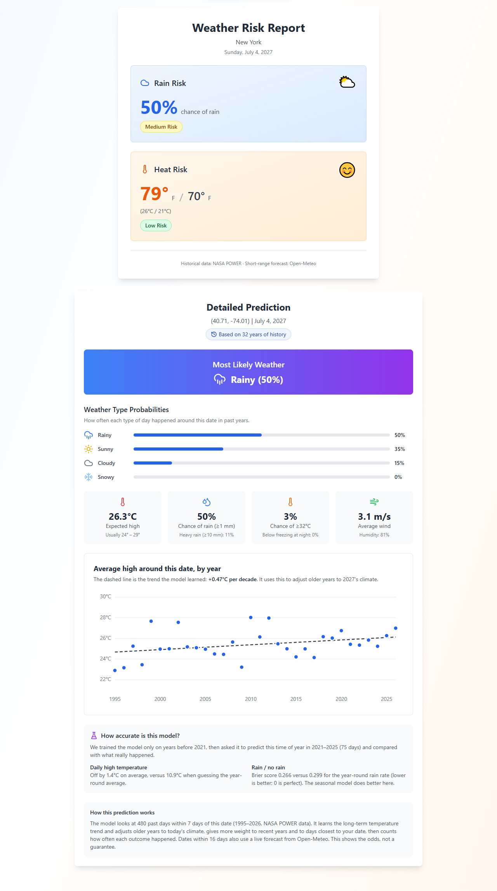

# Will It Rain On My Parade? 🌧️

Planning an outdoor event? Pick a place and a date, and this app estimates the chance of rain, heat and other conditions using **30 years of NASA weather data**, a **trained statistical model**, and a **live forecast** when the date is close.

**Live demo:** _coming soon_



## Features

- **Any place, any date.** Search a city, enter coordinates, or click the map.
- **Rain and heat risk.** Chance of rain, heavy rain, hot days (≥32°C) and freezing nights.
- **Weather-type odds.** How likely a sunny, cloudy, rainy or snowy day is.
- **Climate-aware.** Learns each location's warming trend and adjusts older years to today's climate.
- **Live forecast blend.** Dates within 16 days blend in a real forecast, trusted more the closer the date is.
- **Honest accuracy.** Every prediction includes a backtest showing how the model performed on years it never saw.
- **Past dates.** Shows what actually happened next to what the model would have predicted.

## How the prediction works

Weather can't be forecast day by day more than about two weeks ahead, so for later dates the best estimate is **what usually happens at this place and time of year** (climatology). The model:

1. Downloads daily weather since 1995 for the location from [NASA POWER](https://power.larc.nasa.gov/).
2. Takes every past day within ±7 days of the chosen date (≈450 days).
3. Fits a **linear trend** of temperature over the years, and shifts older years to the target year's climate.
4. **Weights** each day: recent years and days closer to the target date count more.
5. Computes probabilities as weighted frequencies (e.g. rain chance = share of days with ≥1 mm).
6. For dates within 16 days, **blends** in the [Open-Meteo](https://open-meteo.com/) forecast, weighted 90% for tomorrow down to 20% at day 15.

**Validation:** the model is retrained on years before 2021 and tested on 2021–2025. Temperature is scored by average error, and rain by [Brier score](https://en.wikipedia.org/wiki/Brier_score), both compared against a naive year-round-average baseline. Results are shown in the app for every location.

**Limitations:** NASA data is averaged over ~50 km grid cells, so it misses very local effects and tends to count light drizzle as rain. The model shows odds, not a guarantee.

## Tech Stack

| Area | Tools |
|---|---|
| Frontend | React, TypeScript, Vite, Tailwind CSS |
| Map | Leaflet + OpenStreetMap |
| Data | NASA POWER API (history), Open-Meteo (forecast + city search) |
| Model | Custom TypeScript: weighted climatology, linear regression, backtesting |

No backend and no API keys. Everything runs in the browser.

## Project Structure

```
src/
├── model/
│   ├── history.ts       # Downloads & cleans NASA daily data (with caching)
│   ├── climatology.ts   # The model: trend fitting, weighting, probabilities
│   ├── forecast.ts      # Open-Meteo short-range forecast
│   └── predict.ts       # Combines everything + backtest
├── components/          # React UI (results card, chart, map, inputs)
└── App.tsx              # Page layout and state
```

## Getting Started

You need [Node.js](https://nodejs.org/) 18 or newer.

```bash
npm install     # install dependencies
npm run dev     # start at http://localhost:5173
```

| Command | What it does |
|---|---|
| `npm run dev` | Start the development server |
| `npm run build` | Build for production into `dist/` |
| `npm run preview` | Preview the production build |
| `npm run lint` | Check code for problems |

## Future Improvements

- Tune model settings (window size, recency weighting) using the backtest
- Add climate signals such as El Niño as model inputs
- Calibration chart: "when the model says 30%, does it rain 30% of the time?"
- Unit tests for the model
- Serverless cache to reduce API calls at scale

## Data Sources

- [NASA POWER](https://power.larc.nasa.gov/): daily historical weather (MERRA-2 reanalysis)
- [Open-Meteo](https://open-meteo.com/): forecasts and geocoding
- [OpenStreetMap](https://www.openstreetmap.org/): map tiles
